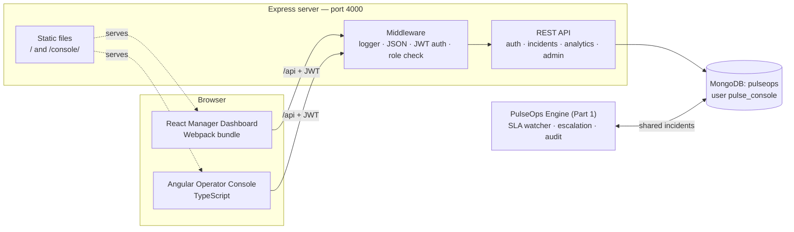
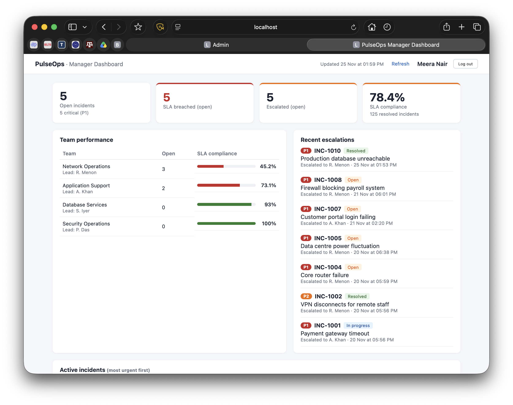
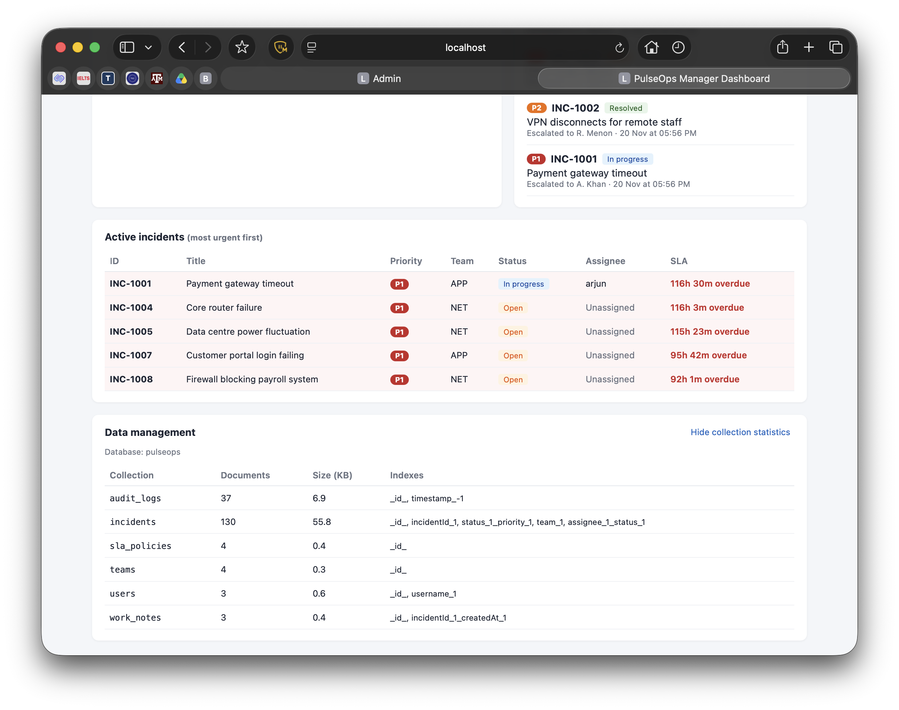
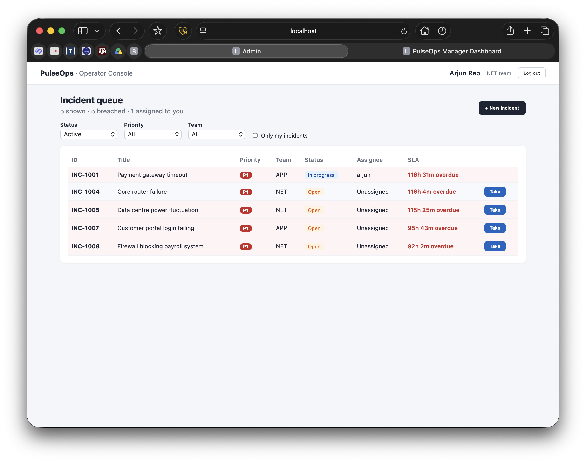
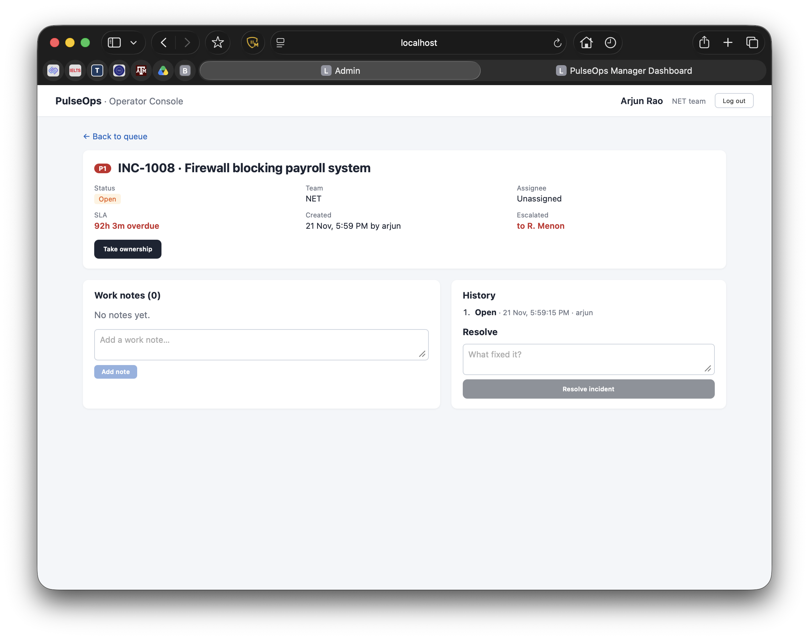
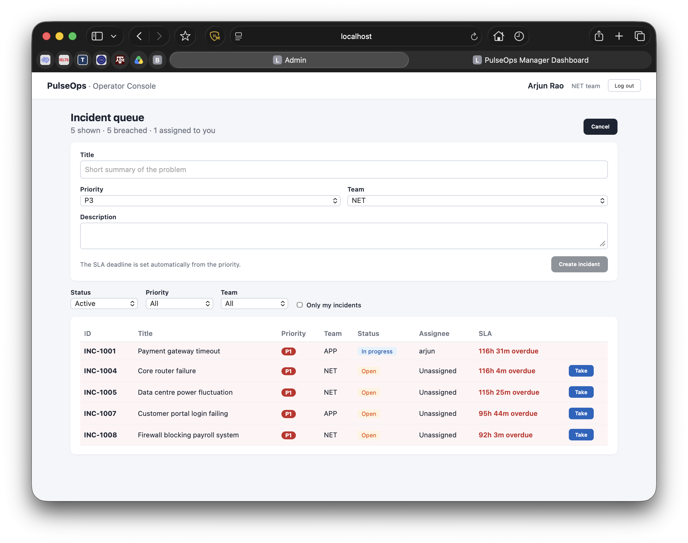
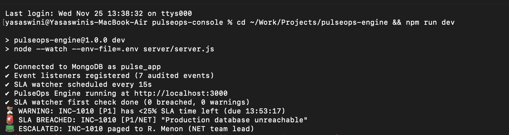
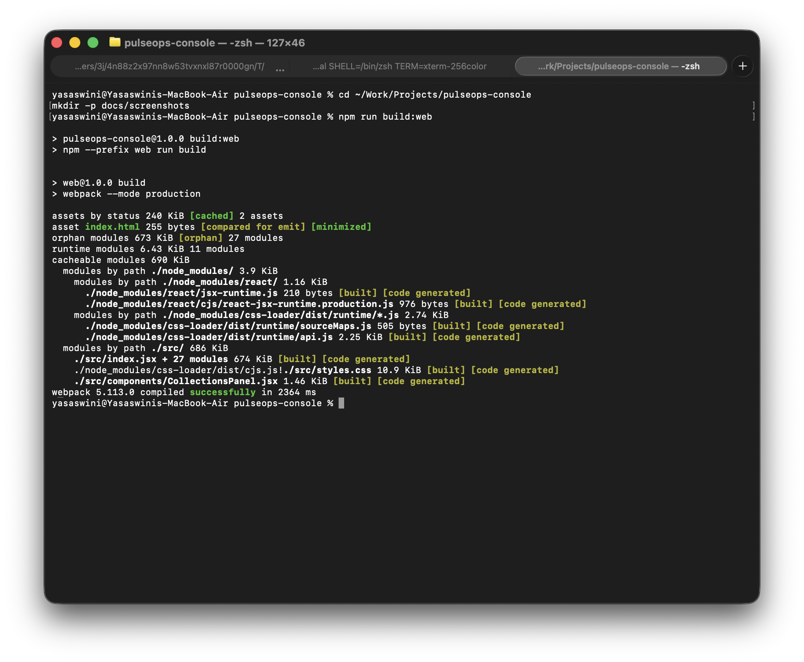
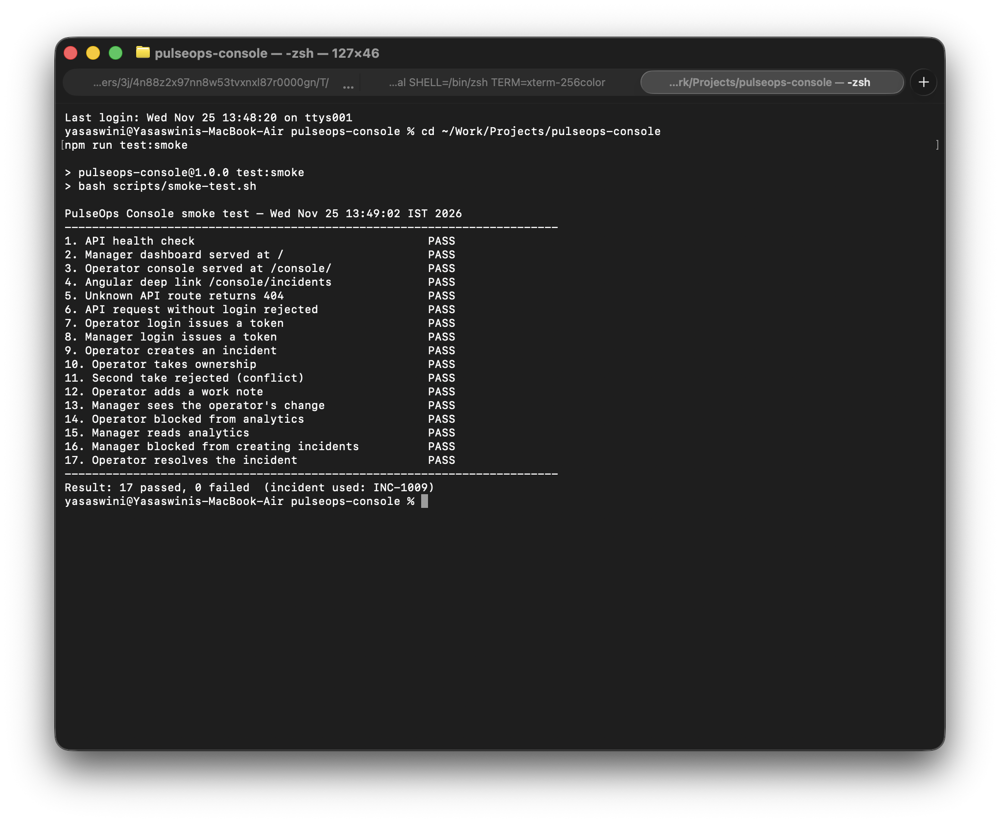

# PulseOps Console

**A full stack management interface for IT incident operations: an Express REST API, a React manager dashboard and an Angular operator console on a shared MongoDB database.**

> **Part 2 of the PulseOps suite.** [PulseOps Engine](https://github.com/yasaswini-p/pulseops-engine) (Part 1) monitors SLAs, escalates breaches and keeps the audit trail. PulseOps Console gives people the tools to see and act on that data. Both run on the same database, so an incident created here is monitored and escalated by the engine automatically.

---

## Who uses it

| User | Application | What they do |
|---|---|---|
| **IT manager** | React dashboard (`/`) | Live KPIs, team SLA compliance, recent escalations, active incident queue, collection statistics |
| **Support engineer** | Angular console (`/console/`) | Filter the queue, create incidents, take ownership, add work notes, resolve incidents |

Each role sees only its own application. The API enforces this, not just the user interface.

---

## Architecture



A single Express server hosts the API and both production-built front-ends, so the whole console is deployed as one process.

---

## Features

**Express REST API**
- Modular routers for `auth`, `incidents`, `analytics` and `admin`
- Middleware pipeline: request logging, JSON parsing, JWT authentication, role-based authorisation and central error handling
- Atomic "take ownership": if two operators claim the same incident, only one succeeds (HTTP 409 for the other)
- Manager analytics built with aggregation pipelines, including a `$lookup` join with team data
- Collection management view: document counts, storage size and indexes per collection

**React manager dashboard**
- Hand-written Webpack configuration: Babel for JSX, CSS bundling, content-hashed file names, dev-server API proxy
- Code splitting: the collection statistics panel is a separate chunk loaded on demand
- Container components (state and data fetching) separated from presentational components (display only)
- Auto-refresh every 15 seconds and live SLA countdowns updated every second

**Angular operator console**
- Strongly typed models and services in TypeScript
- Interpolation, property binding, event binding and two-way binding (`[(ngModel)]`)
- Reusable components (`PriorityBadge`, `SlaCountdown`) and a custom `statusLabel` pipe
- Route guard for protected pages and an HTTP interceptor that attaches the login token
- Signals for reactive state

**Data and security**
- New collections `users` and `work_notes` with JSON Schema validation; validators updated with `collMod`
- New indexes, including a compound index for "my incidents" queries
- Passwords stored as bcrypt hashes; sessions use signed JWTs that expire after 8 hours
- The API connects with a least-privilege database user (`pulse_console`) that **cannot delete data or read the audit trail**

---

## Security model

| Layer | Control |
|---|---|
| **Database** | `pulse_console` user with the custom `consoleOperator` role: read/write incidents, users and work notes; insert-only audit logs; no deletes |
| **API authentication** | bcrypt password check → signed JWT (8 h) required on every `/api` route except login |
| **API authorisation** | `requireRole()` middleware: analytics and admin for managers only, incident changes for operators only |
| **Front-ends** | Each app rejects logins from the other role; Angular route guard blocks pages without a session |

---

## Test results

An automated end-to-end smoke test (`npm run test:smoke`) checks the deployed system: page serving, deep links, authentication, authorisation, the full incident workflow and cross-role visibility.

**Result: 17 / 17 passed.** See [`docs/smoke-test.txt`](docs/smoke-test.txt).

---

## Tech stack

MongoDB 8 · Express 5 · React 19 · Angular · Node.js 24 · Webpack 5 · Babel · TypeScript · JSON Web Tokens · bcrypt

---

## Project structure

```
pulseops-console/
├── api/                        # Express REST API
│   ├── scripts/seed-users.js   # Demo accounts with bcrypt-hashed passwords
│   └── src/
│       ├── config/db.js        # MongoDB connection (pulse_console)
│       ├── controllers/        # auth, incidents, analytics, admin
│       ├── middleware/         # auth, logger, errors
│       ├── routes/             # Express routers
│       ├── app.js              # Middleware pipeline, routes, static hosting
│       └── server.js           # Entry point
├── web/                        # React manager dashboard
│   ├── webpack.config.js
│   └── src/
│       ├── containers/         # LoginContainer, DashboardContainer
│       ├── components/         # Presentational components
│       ├── services/api.js
│       └── utils/format.js
├── admin/                      # Angular operator console
│   └── src/app/
│       ├── pages/              # login, queue, incident detail
│       ├── components/         # PriorityBadge, SlaCountdown
│       ├── services/           # auth, incidents, clock
│       ├── guards/ interceptors/ pipes/ utils/
│       └── models.ts
├── db/01-console-setup.js      # Collections, indexes, role and user
├── scripts/smoke-test.sh       # End-to-end test
└── docs/                       # Test results and screenshots
```

---

## Getting started

**Prerequisites:** Node.js 24, MongoDB with the PulseOps Engine database already set up (see [Part 1](https://github.com/yasaswini-p/pulseops-engine)).

```bash
# 1. Database: collections, indexes, role and user
mongosh "mongodb://localhost:27017/admin" -u pulse_admin -p "<admin password>" db/01-console-setup.js

# 2. Install dependencies
npm --prefix api install && npm --prefix web install && npm --prefix admin install

# 3. Configure the API and create demo accounts
cp api/.env.example api/.env      # then fill in the values
npm --prefix api run seed

# 4. Build both front-ends and start the single server
npm run build
npm start
```

| Address | Application |
|---|---|
| http://localhost:4000/ | Manager dashboard |
| http://localhost:4000/console/ | Operator console |
| http://localhost:4000/api/health | API health check |

**Development mode** (hot reload): run `npm run dev` in `api/`, `npm start` in `web/` (port 8080) and `npm start` in `admin/` (port 4200).

| Command | Purpose |
|---|---|
| `npm run build` | Production build of React and Angular |
| `npm start` | Start the production server |
| `npm run test:smoke` | End-to-end smoke test |

---

## API reference

| Method | Endpoint | Role | Description |
|---|---|---|---|
| `POST` | `/api/auth/login` | — | Log in, returns JWT |
| `GET` | `/api/auth/me` | any | Current user |
| `GET` | `/api/incidents` | any | List; filters `status`, `priority`, `team`, `assignee=me`, `sort=sla` |
| `GET` | `/api/incidents/:id` | any | Incident with work notes |
| `POST` | `/api/incidents` | operator | Create (SLA deadline set from priority) |
| `POST` | `/api/incidents/:id/assign` | operator | Take ownership (atomic) |
| `POST` | `/api/incidents/:id/notes` | operator | Add a work note |
| `POST` | `/api/incidents/:id/resolve` | operator | Resolve with a summary |
| `GET` | `/api/analytics/summary` | manager | KPIs |
| `GET` | `/api/analytics/teams` | manager | Per-team workload and compliance |
| `GET` | `/api/analytics/escalations` | manager | Recent escalations |
| `GET` | `/api/admin/collections` | manager | Collection statistics |

---

## Screenshots

| Manager dashboard | Collection statistics |
|---|---|
|  |  |

| Operator queue | Incident detail |
|---|---|
|  |  |

| New incident form | Engine escalation (Part 1) |
|---|---|
|  |  |

| Webpack build (code splitting) | Smoke test |
|---|---|
|  |  |

---

**Author:** Yasaswini Puchakayala, B.E. Computer Science & Engineering, New Horizon College of Engineering, Bengaluru